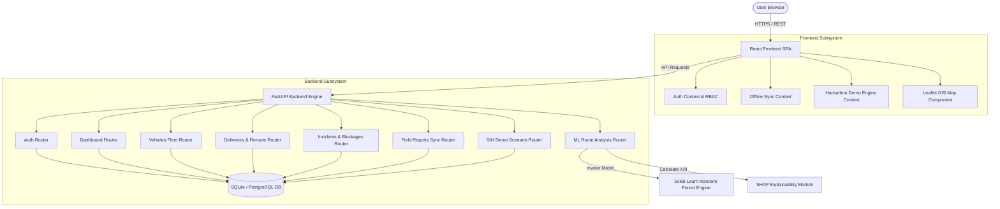

# LINK X8 — Full-Stack Technical Architecture & System Documentation

**Smart India Hackathon 2026 Prototype**  
**Problem Statement ID:** SIH26002  
**Official Problem Statement:** AI-Based Smart Logistics and Accessibility Intelligence Platform for North Eastern Region (NER)  
**Organization:** Ministry of Development of North Eastern Region (MDoNER), Government of India  
**Tagline:** *Predict. Reroute. Deliver.*

---

## 1. Executive Summary & System Overview

The North Eastern Region (NER) of India—encompassing Assam, Arunachal Pradesh, Manipur, Meghalaya, Mizoram, Nagaland, Sikkim, and Tripura—is subject to extreme monsoon rainfall, complex high-altitude terrain, frequent landslides, and flash flooding. Critical supply chains (e.g., life-saving medicines, oxygen cylinders, food relief) rely heavily on vulnerable single-lane arterial corridors like NH27, NH2, and NH37.

**LINK X8** is a Smart Logistics and Accessibility Intelligence Platform designed to monitor accessibility, analyze real-time conditions, identify disruptions, and support intelligent logistics and route decisions for MDoNER, state logistics operators, dispatchers, and field officers. The platform combines:
- Real-time interactive GIS corridor mapping and GPS vehicle tracking.
- An AI Route Risk Engine driven by a Random Forest ensemble model.
- SHAP-inspired Explainable AI (XAI) feature attribution.
- Dynamic automated alternative route calculations and revised ETA delay forecasts.
- An offline-first mobile field reporting workflow with resilient background synchronization.
- Granular Role-Based Access Control (RBAC).

---

## 2. Complete Technology Stack

```
+-----------------------------------------------------------------------+
|                           FRONTEND LAYER                              |
|   React 19 | Vite | Tailwind CSS | Leaflet / React-Leaflet | Recharts |
+-----------------------------------------------------------------------+
                                   │
                              HTTP / REST
                                   ▼
+-----------------------------------------------------------------------+
|                           BACKEND LAYER                               |
|       FastAPI (Python 3.13) | SQLAlchemy 2.0 ORM | Pydantic v2      |
|               JWT Auth (HS256) | SQLite / PostGIS ready               |
+-----------------------------------------------------------------------+
                                   │
                             Inference API
                                   ▼
+-----------------------------------------------------------------------+
|                            AI/ML LAYER                                |
|    Scikit-Learn (Random Forest Ensemble) | Pandas | NumPy | SHAP XAI  |
+-----------------------------------------------------------------------+
```

### Technology Breakdown

| Component | Framework / Library | Version / Tooling | Purpose |
|---|---|---|---|
| **Frontend Framework** | React | `v19.2.8` | Single-page UI application with modular context state |
| **Build Tooling** | Vite | `v8.2.2` | Rapid HMR dev server and optimized client bundler |
| **Styling & UI** | Tailwind CSS | `v3.4.17` | Utility-first responsive design, modern dark/light styling |
| **GIS Mapping** | Leaflet & React-Leaflet | `v1.9.4` / `v5.0.0` | OpenStreetMap rendering, custom markers, polylines |
| **Icons & Charts** | Lucide React / Recharts | `v1.39.0` / `v3.10.1` | Dashboard analytics charts and iconography |
| **HTTP Client** | Axios | `v1.20.0` | Intercepted REST API client with JWT bearer tokens |
| **Backend Web Server** | FastAPI | `v0.115+` | High-performance asynchronous Python web framework |
| **ASGI Server** | Uvicorn | `v0.34+` | Lightning-fast ASGI application server |
| **ORM & Database** | SQLAlchemy 2.0 / SQLite | DB v2.0 | Relational database mapping, expandable to PostgreSQL/PostGIS |
| **Data Validation** | Pydantic v2 | `v2.10+` | Schema parsing, strict type checking, and serialization |
| **Machine Learning** | Scikit-Learn | `v1.6+` | Random Forest Classifier for route risk scoring (0-100) |
| **Explainable AI** | Custom SHAP Engine | In-house Python | Feature attribution calculation for model predictions |

---

## 3. High-Level System Architecture



---

## 4. Backend Database Schemas & Data Models

### Data Models Entity-Relationship Summary

1. **User** (`users`): System user account details, hashed passwords, and assigned operational roles (`Admin`, `Dispatcher`, `Field Officer`, `Viewer`).
2. **Vehicle** (`vehicles`): Fleet vehicle registration, GPS coordinates (`current_lat`, `current_lng`), speed (`speed_kmh`), risk level, and driver details.
3. **Delivery** (`deliveries`): Cargo tracking records, priority level, origin/destination cities, original ETA, revised ETA, delay in minutes, risk score, and active/alternate route JSON polylines.
4. **Incident** (`incidents`): Disruption reports (landslides, flash floods, road blockages) containing GPS coordinates, severity level (`LOW`, `MEDIUM`, `HIGH`, `CRITICAL`), and road status (`PASSABLE`, `PARTIAL`, `BLOCKED`).
5. **Alert** (`alerts`): Command center operational alerts triggered by risk surges or blocked highways.
6. **FieldReport** (`field_reports`): Field officer accessibility reports collected offline and synchronized to the central database.
7. **SystemSettings** (`system_settings`): Configurable operational threshold parameters.
8. **AuditLog** (`audit_logs`): Enterprise compliance trail tracking all login actions, reroute approvals, and field report syncs.

---

## 5. AI Route Risk Engine & Explainability (XAI)

### Feature Contract
The AI engine consumes a 9-feature vector for every corridor evaluation:
1. `distance_km`: Total corridor length in kilometers.
2. `terrain_elevation_gain_m`: Cumulative mountain elevation gain.
3. `rainfall_mm_hr`: Precipitation intensity (mm/hour).
4. `active_incidents_count`: Number of reported disruptions on the route.
5. `highest_severity_numeric`: Numerical severity encoding (0=None, 1=Low, 2=Medium, 3=High, 4=Critical).
6. `road_blocked_status`: Binary flag (0 = Passable, 1 = Completely Blocked).
7. `historical_landslide_freq`: Historical frequency score of landslides on the sector.
8. `traffic_congestion_index`: Congestion multiplier index (0.0 to 1.0).
9. `vehicle_type_risk_multiplier`: Vehicle payload vulnerability index.

### Explainability Engine Output Example
```json
{
  "ml_risk_evaluation": {
    "risk_score": 82.0,
    "risk_category": "CRITICAL",
    "model_version": "v1.0.0-RandomForest"
  },
  "explainable_ai": {
    "primary_reasons": [
      {
        "factor": "Road Blocked Status",
        "impact": "CRITICAL",
        "description": "Completely impassable mountain pass (Landslide on NH27)"
      },
      {
        "factor": "Monsoon Rainfall Intensity",
        "impact": "HIGH",
        "description": "Torrential precipitation (75 mm/hr)"
      }
    ]
  }
}
```

---

## 6. Offline-First Architecture & Sync Strategy

Remote mountain sectors in the North Eastern Region experience frequent cellular network outages.

```
       +--------------------------------------------------------+
       |             Field Officer Device (Mobile)              |
       |  1. Submits report when network is OFFLINE             |
       |  2. Saved instantly to HTML5 localStorage Queue        |
       +--------------------------------------------------------+
                                   │
                        Network Status Detection
                                   │
                      [Online Status Restored]
                                   │
                                   ▼
       +--------------------------------------------------------+
       |            Sync Request (POST /field-reports/sync)     |
       |  Batch payload sent to FastAPI server                  |
       +--------------------------------------------------------+
                                   │
                                   ▼
       +--------------------------------------------------------+
       |                 FastAPI Central Server                 |
       |  1. Inserts records into FieldReports DB               |
       |  2. Converts reports into active Incident map markers  |
       |  3. Triggers AI Risk re-evaluation on deliveries       |
       |  4. Dispatches CRITICAL_ROUTE_ALERT to dispatchers     |
       +--------------------------------------------------------+
```

---

## 7. Complete API Endpoint Specification

Base Endpoint: `http://127.0.0.1:8000/api/v1`

| Category | HTTP Method | Endpoint | Description |
|---|---|---|---|
| **Health** | `GET` | `/health` | Server status check |
| **Auth** | `POST` | `/api/v1/auth/login` | Authenticate user & return JWT token |
| **Auth** | `POST` | `/api/v1/auth/register` | Register new user account |
| **Dashboard** | `GET` | `/api/v1/dashboard/summary` | Combined KPI, risk metrics, and recent alerts |
| **Vehicles** | `GET` | `/api/v1/vehicles` | List all tracked fleet vehicles |
| **Vehicles** | `POST` | `/api/v1/vehicles` | Register new vehicle |
| **Deliveries** | `GET` | `/api/v1/deliveries` | List active deliveries & risk scores |
| **Deliveries** | `POST` | `/api/v1/deliveries` | Dispatch new delivery |
| **Deliveries** | `POST` | `/api/v1/deliveries/{id}/reroute` | Approve Alternate Route B detour |
| **Incidents** | `GET` | `/api/v1/incidents` | List active road disruptions |
| **Incidents** | `POST` | `/api/v1/incidents` | Log new road incident |
| **Routes** | `POST` | `/api/v1/routes/analyze` | Execute AI Risk & SHAP calculation |
| **Alerts** | `GET` | `/api/v1/alerts` | List operational notifications |
| **Alerts** | `PUT` | `/api/v1/alerts/{id}/read` | Mark alert as dismissed |
| **Field Reports** | `POST` | `/api/v1/field-reports/sync` | Synchronize offline report queue |
| **Analytics** | `GET` | `/api/v1/analytics` | Regional accessibility & trend metrics |
| **Audit Logs** | `GET` | `/api/v1/audit-logs` | Retrieve system compliance log |
| **Demo Engine** | `POST` | `/api/v1/demo/trigger-landslide` | Trigger 7-step Hackathon story |
| **Demo Engine** | `POST` | `/api/v1/demo/reset` | Reset demo state to initial clear conditions |

---

## 8. Quick Start Running Instructions

### Prerequisites
- Node.js (v18+) & npm
- Python (3.10+)

### 1. Launch FastAPI Backend Server
```bash
cd backend
py -m uvicorn app.main:app --host 127.0.0.1 --port 8000
```
- API Base URL: `http://127.0.0.1:8000`
- Swagger UI Docs: `http://127.0.0.1:8000/docs`

### 2. Launch React Frontend Application
```bash
cd frontend
npm install
npm run dev
```
- Frontend Web App: `http://localhost:5173/`

---

## 9. Preset Demo Accounts
- **Admin**: `admin@nerlogiai.in` | `Admin@123`
- **Dispatcher**: `dispatcher@nerlogiai.in` | `Dispatch@123`
- **Field Officer**: `field@nerlogiai.in` | `Field@123`
