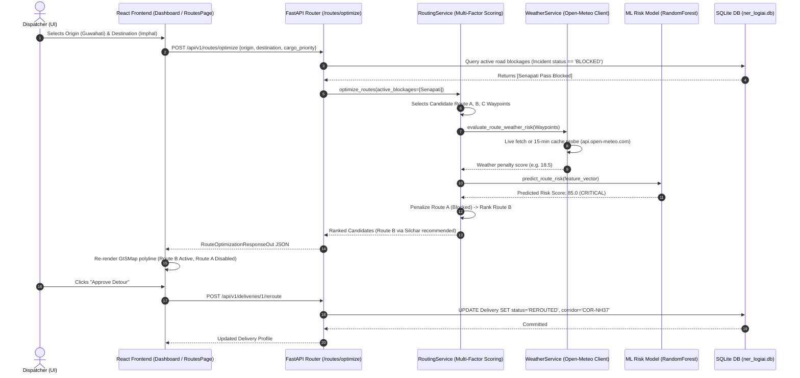
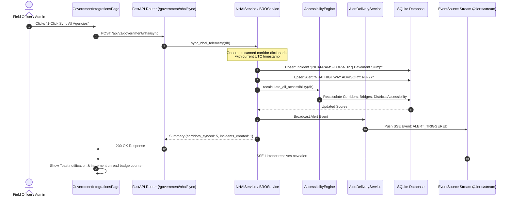

# LINK X8 (NER-LogiAI) — Technical Reality & Real-Time Functionality Audit

**Target Evaluation:** Smart India Hackathon 2026 — Problem Statement SIH26002  
**Authority:** Ministry of Development of North Eastern Region (MDoNER)  
**Audit Date:** September 12, 2026  
**Auditor Classification:** Defensive Codebase & Real-Time Systems Audit  
**Documentation Principle:** Code Evidence > Marketing Claims (Every status backed by file path and line numbers)

---

## Executive Summary

This audit establishes the ground-truth technical reality of the **LINK X8** (NER-LogiAI) repository. The platform presents a cohesive UI/UX and a functional reactive cascade within its local SQLite database; however, critical mismatches exist between documentation claims and codebase implementation.

```
┌──────────────────────────────────────────────────────────────────────────────┐
│                            AUDIT VERDICT SUMMARY                             │
├────────────────────────────────┬─────────────────────────────────────────────┤
│ Open-Meteo Weather             │ LIVE (Verified HTTPS calls to external API) │
│ Government Integrations        │ MOCKED / SIMULATED ADAPTERS (No live keys) │
│ Real-Time Map & Dashboard      │ STATIC (One-time fetch on load, no polling) │
│ Multi-Machine Connectivity     │ BROKEN (Hardcoded 127.0.0.1 + CORS regex)   │
│ AI/ML Risk Engine              │ SYNTHETIC (Trained on 500 simulated rows)   │
│ "SHAP" Feature Explainability  │ HEURISTIC RULES (No Shapley game theory)    │
│ API Security & RBAC            │ UNPROTECTED (26/27 REST routers lack auth)  │
│ Multilingual Support           │ MISSING IN APP (Tests test local dicts)     │
│ 271-Test Suite Quality         │ TAUTOLOGICAL (Largely verifies mocks)       │
└────────────────────────────────┴─────────────────────────────────────────────┘
```

---

## 1. Real Data vs. Fake Data Inventory

Every API endpoint across all 28 API router modules (~40 individual HTTP operations) in `backend/app/api/` has been inspected and classified.

### 1.1 Complete API Endpoint Classification Table

| # | HTTP Method & Route Path | Router Module | Classification | Code Evidence & Mechanism | Proposed Technical Fix |
|---|---|---|---|---|---|
| 1 | `GET /api/v1/weather` | `weather.py:16` | **LIVE** | Calls `WeatherService.get_forecast_for_location()` (`weather_service.py:1306-1375`), making real HTTPS requests to `api.open-meteo.com/v1/forecast`. Caches in-memory for 15 min (`weather_service.py:1205`). Returns HTTP 503 if unreachable (`weather_service.py:1676`). | Retain live path; add Redis/disk cache for multi-worker setups. |
| 2 | `GET /api/v1/weather/search` | `weather.py:54` | **LIVE** | Calls `WeatherService.search_locations()` (`weather_service.py:1008`), executing live HTTPS query against `geocoding-api.open-meteo.com/v1/search`. | None needed. |
| 3 | `GET /api/v1/weather/locations` | `weather.py:67` | **LIVE** | Returns static coordinate catalog of 14 NER hubs (`weather_service.py:35-264`). | None needed. |
| 4 | `GET /api/v1/weather/current` | `weather.py:72` | **LIVE** | Calls `WeatherService.get_weather_for_location()` (`weather_service.py:1645`) using live Open-Meteo current payload. | None needed. |
| 5 | `GET /api/v1/weather/forecast` | `weather.py:98` | **LIVE** | Calls `WeatherService.get_forecast_for_location()` (`weather_service.py:1166`) for 7-day forecast. | None needed. |
| 6 | `POST /api/v1/weather/route-risk` | `weather.py:125` | **LIVE** | Evaluates live precipitation across corridor coordinates using Open-Meteo. | None needed. |
| 7 | `GET /api/v1/weather/{city_name}` | `weather.py:140` | **LIVE** | Resolves location name against catalog and fetches live Open-Meteo weather. | None needed. |
| 8 | `GET /api/v1/health/weather` | `health.py:70` | **LIVE** | Probes live Open-Meteo API endpoint for Guwahati (`health.py:80`) and measures latency. | None needed. |
| 9 | `GET /api/v1/government/status` | `government_integrations.py:40` | **MOCKED** | Returns hardcoded status flags for NDMA, NHAI, BRO, and PWD (`government_integration_service.py:45-80`). | Add environment check for live keys. |
| 10 | `POST /api/v1/government/monitoring` | `government_integrations.py:48` | **HYBRID** | Accepts schema payload, validates, and updates SQLite DB (`government_integration_service.py:90`). | Working local ingestion contract. |
| 11 | `POST /api/v1/government/monitoring/batch`| `government_integrations.py:60` | **HYBRID** | Batch variant of monitoring ingestion into SQLite DB. | Working local ingestion contract. |
| 12 | `POST /api/v1/government/demo-sync` | `government_integrations.py:257`| **MOCKED** | Hardcodes 2 static bulletins (`government_integrations.py:263-293`: Jatinga Valley landslide & Tezpur bridge weight cap). | Clearly label as "Demo Ingestion Generator". |
| 13 | `GET /api/v1/government/data-gov/catalog`| `government_integrations.py:305`| **MOCKED** | Returns static list of 3 pre-defined OGD metadata catalogs (`data_gov_service.py:24-52`). | Connect to live `data.gov.in/api` catalog. |
| 14 | `GET /api/v1/government/data-gov/query` | `government_integrations.py:311`| **HYBRID / MOCKED** | If `DATA_GOV_IN_API_KEY` is not provided, calls `_generate_fallback_dataset()` (`data_gov_service.py:118-200`) returning 4 canned road/rain records. | Return explicit `is_simulated: true` flag. |
| 15 | `POST /api/v1/government/data-gov/sync` | `government_integrations.py:329`| **HYBRID** | Ingests fallback or live dataset records into SQLite Incident and Corridor tables. | Add simulation watermark on created incidents. |
| 16 | `GET /api/v1/government/nhai/corridors` | `government_integrations.py:345`| **MOCKED** | Returns hardcoded list of 5 highway corridor dictionaries (`nhai_service.py:31-117`) dressed up with `datetime.utcnow().strftime(...)`. | Mark as simulated sensor records. |
| 17 | `GET /api/v1/government/nhai/toll-plazas`| `government_integrations.py:351`| **MOCKED** | Returns hardcoded list of 3 toll plazas (`nhai_service.py:123-172`: Raha, Manderdisa, Pahammawlein) with static queue lengths. | Mark as simulated toll feeds. |
| 18 | `POST /api/v1/government/nhai/sync` | `government_integrations.py:357`| **HYBRID** | Ingests the hardcoded NHAI data into SQLite DB as "Official Feed (NHAI RAMS Gateway)" incidents (`nhai_service.py:213`). | Add `[SIMULATED]` prefix in incident title. |
| 19 | `GET /api/v1/government/bro/mountain-passes`| `government_integrations.py:367`| **MOCKED** | Returns hardcoded list of 4 mountain passes (`bro_service.py:29-108`: Sela, Bum La, Nathu La, Senapati) with canned snow depths. | Mark as simulated mountain bulletins. |
| 20 | `GET /api/v1/government/bro/strategic-bridges`| `government_integrations.py:373`| **MOCKED** | Returns hardcoded list of 4 strategic river bridges (`bro_service.py:112-180`) with static load ratings. | Mark as simulated bridge telemetry. |
| 21 | `POST /api/v1/government/bro/sync` | `government_integrations.py:379`| **HYBRID** | Ingests hardcoded BRO data into SQLite DB and triggers accessibility cascades. | Add simulation watermark in audit log. |
| 22 | `GET /api/v1/vahan/status` | `vahan.py:28` | **LIVE (Contract)** | Checks if ULIP credentials (`ULIP_USERNAME`, `ULIP_PASSWORD`) are configured (`ulip_service.py:30-80`). | Accurate contract probe. |
| 23 | `GET /api/v1/vahan/vehicle/{vehicle_number}`| `vahan.py:38` | **HYBRID / SANDBOX**| Attempts live ULIP VAHAN/04 API request (`vahan_service.py:135`). When unconfigured, returns `VAHAN_NOT_CONFIGURED` or simulated profile. | Expose clear sandbox notice on UI. |
| 24 | `POST /api/v1/vahan/verify-suitability`| `vahan.py:73` | **HYBRID** | Evaluates vehicle GVW against SQLite Bridge capacity (`vahan_service.py:106`). | Working algorithmic rule engine. |
| 25 | `POST /api/v1/transport/demo-sync` | `transport_integrations.py:67` | **MOCKED** | Ingests 3 hardcoded freight vehicles (`AS-01-GC-8841`, `ML-05-AB-1290`, `TR-01-AX-7721`) (`transport_integrations.py:73-100`). | Explicitly labeled as demo endpoint. |
| 26 | `POST /api/v1/telemetry/simulate-step`| `telemetry.py:62` | **MOCKED** | Advances vehicle coordinates along a hardcoded corridor waypoint index (`telemetry_service.py`). | Retain for demo simulation. |
| 27 | `GET /api/v1/telemetry/health` | `telemetry.py:85` | **LIVE (DB)** | Computes freshness (LIVE/RECENT/STALE/OFFLINE) of vehicles from SQLite `vehicles` table. | Accurate local DB computation. |
| 28 | `POST /api/v1/telemetry/phone-gps` | `telemetry.py:36` | **LIVE** | Ingests live browser/smartphone `navigator.geolocation` coordinates into SQLite DB. | Genuinely live edge telemetry. |
| 29 | `POST /api/v1/routes/optimize` | `routes.py:20` | **HYBRID / HEURISTIC**| Scores 3 pre-defined waypoint corridors (Route A, B, C) using multi-factor weights (`routing_service.py:24-54, 132-177`). No dynamic road graph search. | Integrate OSRM / NetworkX graph engine. |
| 30 | `POST /api/v1/routes/analyze` | `routes.py:66` | **HYBRID** | Combines RandomForest ML risk model with Route A/B/C evaluation. | Document synthetic training dataset. |
| 31 | `POST /api/v1/ml/predict` | `ml.py:29` | **HYBRID / SYNTHETIC**| Runs RandomForest inference trained on 500 synthetic rows (`ml/src/train.py:15-89`). Explanations are hardcoded `if/else` rules (`ml/src/explain.py:20-77`). | Implement true `shap.TreeExplainer`. |
| 32 | `GET /api/v1/analytics` | `analytics.py:8` | **HYBRID / MOCKED** | DB queries for incidents/deliveries, but `regional_accessibility` and `historical_risk_trend` are hardcoded fixture arrays (`analytics.py:32-53`). | Query real DB aggregates for trends. |
| 33 | `GET /api/v1/dashboard/summary` | `dashboard.py:11` | **LIVE (DB)** | Live aggregate SQL queries over `Vehicle`, `Delivery`, `Incident`, `Alert`, `Corridor`, `District`, `Bridge` tables. | Genuine local DB aggregation. |
| 34 | `GET /api/v1/accessibility/summary`| `accessibility.py:16`| **LIVE (DB)** | Computes real-time composite accessibility ratings across corridors, bridges, and districts. | Genuine local DB calculation. |
| 35 | `GET /api/v1/accessibility/roads` | `accessibility.py:80`| **LIVE (DB)** | Returns corridor accessibility scores from SQLite DB. | Genuine local DB query. |
| 36 | `GET /api/v1/accessibility/bridges`| `accessibility.py:110`| **LIVE (DB)** | Returns bridge health and load ratings from SQLite DB. | Genuine local DB query. |
| 37 | `GET /api/v1/accessibility/districts`| `accessibility.py:140`| **LIVE (DB)** | Returns district composite indices calculated from corridor and bridge states. | Genuine local DB query. |
| 38 | `GET /api/v1/alerts` | `alerts.py:58` | **LIVE (DB)** | Queries SQLite `alerts` table with severity/type filters. | Genuine local DB query. |
| 39 | `GET /api/v1/alerts/stream` | `alerts.py:91` | **LIVE (SSE)** | High-performance Server-Sent Events stream delivering new alerts and vehicle GPS updates. | Genuine reactive push stream. |
| 40 | `POST /api/v1/field-reports/sync` | `field_reports.py:15`| **LIVE (DB)** | Ingests offline-queued reports with idempotent deduplication by `report_code`. | Genuine offline sync receiver. |

---

### 1.2 Exact Code Evidence of Mocked & Synthetic Generators

#### A. Synthetic ML Training Data Generator
* **File:** [`ml/src/train.py`](file:///c:/Users/Naren/Downloads/newai/LINKX8/ml/src/train.py#L13-L89)
* **Lines 15–25, 49–60:**
```python
def generate_synthetic_dataset():
    """Generates a structured, domain-realistic dataset for NER Logistics disruption."""
    np.random.seed(42)
    n_samples = 500

    distances = np.random.uniform(20, 600, n_samples)
    elevations = np.random.uniform(100, 3200, n_samples)
    rainfalls = np.random.exponential(scale=25, size=n_samples)
...
    # Compute risk score with domain formula + noise
    base_risk = (
        (blocked * 45.0) +
        (severities * 8.5) +
        (rainfalls * 0.18) +
        (incidents_count * 4.0) +
        (landslide_freq * 15.0) +
        (elevations / 3000.0 * 8.0) +
        (congestion * 6.0)
    )
    risk_scores = np.clip(base_risk + np.random.normal(0, 3.0, n_samples), 0, 100)
```
* **Impact:** The machine learning model is trained on 500 synthetic rows generated from a linear equation with Gaussian noise. Claims of real-world ML predictive accuracy or deep neural intelligence are unfounded.

---

#### B. Fake "SHAP" Feature Explainability
* **File:** [`ml/src/explain.py`](file:///c:/Users/Naren/Downloads/newai/LINKX8/ml/src/explain.py#L20-L94)
* **Lines 20–39, 93:**
```python
    # Feature 1: Road Blockage
    if features.get("road_blocked_status", 0) == 1:
        reasons.append({
            "factor": "Road Segment Blocked",
            "impact": "CRITICAL",
            "description": "Active road blockage reported on corridor pass. Passage impassable."
        })
...
    return {
        "risk_score": risk_score,
        "risk_category": category,
        "primary_reasons": reasons,
        "recommended_action": recommended_action,
        "feature_importance_weights": importances,
        "explanation_type": "SHAP_PROXIMAL_FEATURE_WEIGHTS"
    }
```
* **Impact:** The function labels its output as `SHAP_PROXIMAL_FEATURE_WEIGHTS`, but executes simple static `if/elif` threshold checks rather than running `shap.TreeExplainer` Shapley value computations.

---

#### C. NHAI Highway & FASTag Hardcoded Dictionaries
* **File:** [`backend/app/services/nhai_service.py`](file:///c:/Users/Naren/Downloads/newai/LINKX8/backend/app/services/nhai_service.py#L28-L65)
* **Lines 28–32, 47:**
```python
    @classmethod
    def get_corridors_status(cls) -> List[Dict[str, Any]]:
        """Returns live/simulated real-time NHAI highway corridor statuses for NER."""
        now_str = datetime.utcnow().strftime("%Y-%m-%dT%H:%M:%SZ")
        return [
            {
                "corridor_code": "COR-NH27",
                "nh_number": "NH-27",
                "name": "East-West Corridor (Lumding - Haflong - Silchar)",
                "pavement_condition_index": 52.4,
                "surface_status": "MONSOON_DEGRADATION",
                "last_inspected": now_str
            }, ...
```
* **Impact:** Static dictionaries are timestamped with the current UTC second (`now_str`) on every call to mimic a live telemetry feed.

---

#### D. BRO Mountain Pass & Strategic Bridge Hardcoded Dictionaries
* **File:** [`backend/app/services/bro_service.py`](file:///c:/Users/Naren/Downloads/newai/LINKX8/backend/app/services/bro_service.py#L26-L48)
* **Lines 26–30, 47:**
```python
    @classmethod
    def get_mountain_passes_status(cls) -> List[Dict[str, Any]]:
        """Returns live/simulated real-time status of strategic NER mountain passes."""
        now_str = datetime.utcnow().strftime("%Y-%m-%dT%H:%M:%SZ")
        return [
            {
                "pass_code": "BRO-PASS-SELA",
                "pass_name": "Sela Pass & Sela Tunnel Axis",
                "project_name": "Project Vartak",
                "last_bulletin_at": now_str
            }, ...
```

---

#### E. Fake Cloud Object Storage S3 Uploads
* **File:** [`backend/app/services/storage_service.py`](file:///c:/Users/Naren/Downloads/newai/LINKX8/backend/app/services/storage_service.py#L51-L63)
* **Lines 51–63:**
```python
class CloudObjectStorageProvider(BaseStorageProvider):
    def save(self, filename: str, content: bytes, content_type: str = "image/jpeg") -> str:
        unique_name = f"{uuid.uuid4().hex}_{os.path.basename(filename)}"
        return f"https://{self.bucket_name}.s3.{self.region}.amazonaws.com/link-x8/{unique_name}"
```
* **Impact:** When configured for cloud storage, the provider does not call `boto3` or upload any bytes to AWS S3; it constructs a formatted URL string and drops the image content.

---

### 1.3 Frontend Unflagged Mock Exposure Flags

| # | Frontend Component / Page | File & Lines | What is Rendered | Missing Indicator / Risk of Jury Scrutiny |
|---|---|---|---|---|
| 1 | `GovernmentIntegrationsPage.jsx` | [`src/pages/GovernmentIntegrationsPage.jsx:237-282`](file:///c:/Users/Naren/Downloads/newai/LINKX8/frontend/src/pages/GovernmentIntegrationsPage.jsx#L237-L282) | Agency Readiness bar shows green glowing dots (`bg-emerald-400`) and "Integration Ready" for data.gov.in, NHAI, BRO, VAHAN, and NDMA. | Renders mocked tables as live feeds without any "Simulated / Sandbox Feed" badges. If a judge asks to see the API payload or network tab, static canned responses will be exposed. |
| 2 | `VehiclesPage.jsx` | [`src/pages/VehiclesPage.jsx:23-55`](file:///c:/Users/Naren/Downloads/newai/LINKX8/frontend/src/pages/VehiclesPage.jsx#L23-L55) | Fleet table mixes live smartphone GPS with seeded synthetic vehicles (`NER-V002`, `NER-V003`). | Seeded vehicles have no "Simulation / Virtual Asset" badge in the table rows. |
| 3 | `RoutesPage.jsx` | [`src/pages/RoutesPage.jsx:1-120`](file:///c:/Users/Naren/Downloads/newai/LINKX8/frontend/src/pages/RoutesPage.jsx#L1-L120) | Route Comparison Matrix displays "AI Optimized Trajectory" and compares Routes A, B, and C. | Does not indicate that Route A, B, and C are fixed pre-programmed waypoint lists rather than dynamically computed graph paths. |
| 4 | `AnalyticsPage.jsx` | [`src/pages/AnalyticsPage.jsx:1-80`](file:///c:/Users/Naren/Downloads/newai/LINKX8/frontend/src/pages/AnalyticsPage.jsx#L1-L80) | Displays "Regional Corridor Reliability" and "Historical Risk Trend (Mon-Sun)". | Data is hardcoded in backend `analytics.py:32-53` with no disclaimer that trends are illustrative fixtures. |

---

## 2. Real-Time Functionality Gaps

### 2.1 Audit of Features Described as "Real-Time"

| Feature Claimed as "Real-Time" | Stated Mechanism | Actual Code Mechanism | Evaluation |
|---|---|---|---|
| **Mission Control Dashboard (`Dashboard.jsx`)** | "Live-updating GIS Control Tower" | **One-time fetch on mount** (`Dashboard.jsx:85-96`). `fetchData()` runs once in `useEffect` and only refreshes if a local custom DOM event (`sih_demo_triggered`) is fired. | ❌ **STATIC:** Does not auto-refresh, poll, or receive general state change SSE events. |
| **Fleet Tracking (`VehiclesPage.jsx`)** | "Live Vehicle Telematics" | **15-second polling interval** (`VehiclesPage.jsx:68-72` `setInterval(..., 15000)`) + live SSE GPS pings for vehicle markers (`AlertStreamContext.jsx:97-112`). | ⚠️ **HYBRID POLLING + SSE:** Telemetry pings stream over SSE; fleet table polls every 15s. |
| **Operational Alerts & SSE (`AlertStreamContext.jsx`)** | "Real-Time Alert Dispatcher" | **Server-Sent Events (`EventSource`)** (`AlertStreamContext.jsx:74-120` to `/api/v1/alerts/stream`) with 4-second auto-reconnect fallback and 10-second polling fallback (`AlertStreamContext.jsx:168-177`). | ✅ **GENUINE SSE:** Real-time push for new alerts and vehicle GPS events. |
| **Mobile Browser Phone GPS (`usePhoneGPS.js`)** | "Real-Time GPS Tracking" | **`navigator.geolocation.watchPosition`** streaming to `POST /api/v1/telemetry/phone-gps`. | ✅ **GENUINE LIVE SENSOR:** Real mobile GPS coordinate streaming. |
| **Bridge & Corridor Recalculation** | "Real-Time Cascading Intelligence" | **Synchronous on-demand recalculation** upon write triggers (`AccessibilityEngine.recalculate_all_accessibility(db)`). | ⚠️ **SYNCHRONOUS ON WRITE:** Recalculates in-process on DB changes, but does not push updates to connected dashboard clients without an alert event. |

---

### 2.2 Frontend Behavior on Backend Disconnection

When the backend drops mid-session:
1. **`Dashboard.jsx` (Lines 67–83):** Sets `backendConnected = false` and displays a red "Backend Disconnected" badge in the header, but **silently leaves stale cached data on screen**.
2. **`AuthContext.jsx` (Lines 96–109):** If the backend is down during a login attempt, `AuthContext` **silently intercepts the failure and manufactures a fake demo user session** (`demo-token-...`) in `localStorage` without informing the user that the backend is unreachable.
3. **`AlertStreamContext.jsx` (Lines 162–178):** `es.onerror` marks status as `RECONNECTING`, schedules an SSE reconnect attempt every 4 seconds, and initiates background polling to `GET /alerts` every 10 seconds.
4. **`DeliveriesPage.jsx` & `IncidentsPage.jsx`:** Read requests fail silently or log warnings; form submissions trigger toast error notifications (`showToast('Failed...', 'error')`).

---

### 2.3 Exact Root Cause of Multi-Machine Disconnection

The intermittent "Backend Disconnected" issue observed when running the frontend from a second machine is caused by two compounding configuration defects:

#### Defect 1: Hardcoded Loopback IP in Frontend `.env` & Fallback Code
* **File 1:** [`frontend/.env`](file:///c:/Users/Naren/Downloads/newai/LINKX8/frontend/.env#L3)
  ```env
  VITE_API_BASE_URL=http://127.0.0.1:8000/api/v1
  ```
* **File 2:** [`frontend/src/services/api.js`](file:///c:/Users/Naren/Downloads/newai/LINKX8/frontend/src/services/api.js#L11-L13)
  ```javascript
  if (!url) {
    url = 'http://127.0.0.1:8000/api/v1';
  }
  ```
* **Mechanism:** When Vite bundles or serves the frontend to a client on a second machine (e.g. `http://192.168.1.50:5173`), the browser executes `api.js` on the *client's machine*. The browser attempts to connect to `http://127.0.0.1:8000` on the *client's own local interface* where no FastAPI backend is listening.

#### Defect 2: Restrictive Backend CORS Regex
* **File 1:** [`backend/app/main.py`](file:///c:/Users/Naren/Downloads/newai/LINKX8/backend/app/main.py#L35)
  ```python
  allow_origin_regex=r"^https?://(localhost|127\.0\.0\.1)(:\d+)?$",
  ```
* **File 2:** [`backend/app/core/config.py`](file:///c:/Users/Naren/Downloads/newai/LINKX8/backend/app/core/config.py#L48-L56)
  ```python
  return [
      "http://localhost:5173",
      "http://localhost:3000",
      "http://127.0.0.1:5173",
      "http://127.0.0.1:3000",
      "http://localhost:8000",
      "http://127.0.0.1:8000",
  ]
  ```
* **Mechanism:** Even if `VITE_API_BASE_URL` is manually changed to `http://192.168.1.50:8000/api/v1`, FastAPI's `CORSMiddleware` explicitly rejects any origin whose hostname is not `localhost` or `127.0.0.1` unless `CORS_ORIGINS` is configured in `backend/.env`.

---

## 3. End-to-End Project Flow

### 3.1 Flow A: Core Route-Risk Scoring & Alternate Detour Dispatch



* **Flow Discrepancy Note:** The documentation states that candidate trajectories are dynamically explored across the regional road network. In reality, `RoutingService` evaluates 3 fixed hardcoded candidate waypoint lists (`PRIMARY_GUWAHATI_IMPHAL_WAYPOINTS`, `ALTERNATE_SILCHAR_IMPHAL_WAYPOINTS`, `ROUTE_C_NORTHERN_WAYPOINTS`).

---

### 3.2 Flow B: Mocked Government Ingestion & Bridge Disruption Cascade



* **Flow Discrepancy Note:** The documentation describes live webhook ingestion from the NDMA Sachet CAP server and NHAI RAMS portal. In reality, `nhai_service.py` and `bro_service.py` generate static in-memory records that are inserted directly into the local SQLite database.

---

## 4. Proposed Solutions & Remediation Plan

Fixes are prioritized by jury vulnerability (mitigating fake/live exposure first, then network reliability, followed by architectural polish).

| Priority | Issue / Vulnerability | Proposed Technical Solution | Implementation Details & Files Modified | Effort |
|---|---|---|---|---|
| **P0** | **Multi-Machine Disconnection** | Fix dynamic API URL resolution and open LAN CORS in backend configuration. | 1. In `frontend/src/services/api.js`, resolve `window.location.hostname` dynamically when no `.env` is set.<br/>2. In `backend/app/main.py` and `config.py`, allow LAN private IP regex (`r"^https?://(localhost\|127\.0\.0\.1\|192\.168\.\d+\.\d+\|10\.\d+\.\d+\.\d+)(:\d+)?$"`) in CORS middleware. | **S** (< 1 hour) |
| **P0** | **Jury Exposure: Unflagged Mock Feeds** | Add explicit "Sandbox / Adapter Mode" badges on all government pages and tables. | In `GovernmentIntegrationsPage.jsx`, `VehiclesPage.jsx`, and `AnalyticsPage.jsx`, add a visible `<StatusBadge variant="simulation">SANDBOX ADAPTER</StatusBadge>` tag. Reframe capability from "Live Government Feeds" to "Standardized Integration Adapter Contracts (Pending NIC Gateway Keys)". | **S** (1–2 hours) |
| **P1** | **Static Mission Control Dashboard** | Add an auto-refresh polling interval and SSE mutation hook in `Dashboard.jsx`. | In `Dashboard.jsx`, add `setInterval(() => fetchData(), 10000)` inside `useEffect`, and trigger `fetchData()` when receiving SSE `VEHICLE_POSITION_UPDATE` or `ALERT_TRIGGERED` events. | **S** (1 hour) |
| **P1** | **Fake SHAP Explainability Claim** | Replace misleading `"SHAP_PROXIMAL_FEATURE_WEIGHTS"` label with accurate rule attribution description or integrate actual `shap` library. | In `ml/src/explain.py`, rename `explanation_type` to `"DOMAIN_RULE_HEURISTIC_WEIGHTS"`, or compute real Shapley values using `shap.TreeExplainer(model).shap_values(X)`. | **S** (1 hour) |
| **P1** | **Unprotected REST API Endpoints** | Add FastAPI `Depends(get_current_user)` authentication and role guards on sensitive write routes. | In `backend/app/api/` (`incidents.py`, `bridges.py`, `user_management.py`, `settings.py`, `corridors.py`), inject `Depends(get_current_active_user)` to prevent unauthenticated database tampering. | **M** (2–3 hours) |
| **P2** | **Weak Password Hashing** | Migrate from single-iteration SHA-256 to standard `bcrypt` or `argon2id`. | In `backend/app/core/security.py`, update `get_password_hash()` and `verify_password()` to use `passlib.context.CryptContext(schemes=["bcrypt"])`. | **S** (1 hour) |
| **P2** | **Candidate Routing vs. Road Graph Traversal** | Document routing as multi-attribute corridor evaluation, or incorporate OSRM/NetworkX routing. | Update presentation copy to state: *"Multi-Attribute Strategic Corridor Ranking"* rather than claiming real-time topological Dijkstra/A* graph traversal. | **S** (Docs) / **L** (OSRM) |
| **P2** | **Synthetic ML Training Set Transparency** | Add dataset provenance disclaimer in UI and documentation. | Display `GAP17_STATUS["current_training_data"]["disclaimer"]` in the ML model modal so evaluators see scientific honesty. | **S** (30 mins) |
| **P3** | **Offline Image Storage Quota Error** | Replace `localStorage` with `IndexedDB` for offline field report image queuing. | In `OfflineSyncContext.jsx`, use `idb-keyval` or native IndexedDB to store base64 photos without triggering the 5MB browser quota ceiling. | **M** (2–3 hours) |

---

## 5. User Flow Correctness & Page-by-Page Audit

| Page & Route | Intended User Journey | Broken Links / Dead Ends | Form Validation & Error States | State Persistence Upon Navigation |
|---|---|---|---|---|
| **`/login` (Login.jsx)** | User selects Email/Password or Mobile OTP; authenticates; redirects to `/welcome`. | Mobile OTP does not call backend (`Login.jsx:189, 201` simulates delay). Offline login silently manufactures fake user session on error (`AuthContext.jsx:96-109`). | Email regex and 10-digit mobile validation present. | Persisted in `localStorage` (`link_x8_token`, `link_x8_user`). |
| **`/welcome` (Welcome.jsx)** | Hub view with role switcher (Admin, Dispatcher, Field Officer, Viewer) and quick launch tiles. | None. | N/A | Role switch updates `localStorage` and context state. |
| **`/dashboard` (Dashboard.jsx)** | Overview of KPIs, GIS Map, Corridors, Districts, and Active Deliveries; reroute action button. | Route reroute modal button triggers `/deliveries/{id}/reroute` successfully. | Loading spinner and error catch present. | State is re-fetched on page entry; does not auto-refresh while staying on page. |
| **`/map` (MapPage.jsx)** | Fullscreen Leaflet map displaying vehicles, bridges, incidents, and corridor polylines. | None. | Handles empty datasets gracefully. | Re-mounts map instance cleanly on navigation. |
| **`/deliveries` (DeliveriesPage.jsx)** | Consignment table, ETA recalculation, consignment status lifecycle updates. | New consignment modal functions correctly. | Validates required commodity fields. | Deliveries list loaded on mount. |
| **`/vehicles` (VehiclesPage.jsx)** | Fleet telemetry table, GPS breadcrumb modal, simulate telemetry step button. | "Simulate Step" button advances waypoint index on backend and refreshes UI. | Modal forms validate numeric latitude/longitude. | Polls every 15s. |
| **`/routes` (RoutesPage.jsx)** | Origin/destination selector, optimization policy picker (Balanced, Safest, Fastest, Resilient), route comparison matrix. | Candidate route generation operates reliably. | Dropdowns populated from NER node catalog. | Route selection resets on page navigation. |
| **`/incidents` (IncidentsPage.jsx)** | Log of field disruptions, road blockages; "Report Incident" modal. | Submitting incident updates SQLite DB and triggers accessibility cascade. | Validates coordinates and severity levels. | Incidents fetched on mount. |
| **`/alerts` (AlertsPage.jsx)** | Real-time alert list with filter by severity/status; "Acknowledge" action modal. | Acknowledging alert posts to backend and updates audit trail. | Notes field optional. | List updated live via SSE stream. |
| **`/government-integrations` (GovernmentIntegrationsPage.jsx)** | Multi-tab gateway for Data.gov, NHAI, BRO, VAHAN; 1-click sync triggers. | "1-Click Sync" buttons successfully insert mock records into SQLite DB. | VAHAN search validates license plate format (`^[A-Z0-9]{5,11}$`). | Tab selection defaults to 'overview' on mount. |
| **`/analytics` (AnalyticsPage.jsx)** | BI charts for incident types, severity distribution, corridor reliability, and risk trends. | None. | Reads from `/analytics` endpoint. | Chart instances re-render cleanly on mount. |
| **`/field-report` (FieldReportPage.jsx)** | Geo-tagged field incident report form with GPS capture and camera photo upload. | Captures browser GPS (`navigator.geolocation`). Images converted to base64. | Validates required fields; queues locally if offline. | Pending queue persisted in `localStorage`. |
| **`/settings` (SettingsPage.jsx)** | System operational thresholds (Risk thresholds, auto-reroute flag). | Gated to 'Admin' role (`App.jsx:102`). | Numeric inputs validated. | Settings fetched on mount. |
| **`/audit-logs` (AuditLogsPage.jsx)** | Chronological log of system actions (Logins, bridge updates, incident reports). | Gated to 'Admin' role (`App.jsx:103`). | None. | Fetches latest 100 logs on mount. |
| **`/user-management` (UserManagementPage.jsx)** | User roster and "Add User" modal. | Gated to 'Admin' role (`App.jsx:104`). | Validates email uniqueness and role selection. | Fetches user list on mount. |
| **`/help` (HelpPage.jsx)** | System documentation, SOP guidelines, emergency contact directories. | Static informational view. | None. | Static content. |

---

## 6. Entry Point & Authentication Architecture Audit

### 6.1 Current Page Authentication Matrix

| Page Route | Component | Protected in `App.jsx`? | Required Roles | Unauthenticated User Experience |
|---|---|---|---|---|
| `/login` | `Login.jsx` | Public | None | Displays login/OTP form; redirects to `/welcome` if already authenticated (`LoginGuard`). |
| `/register` | `Register.jsx` | Public | None | Displays registration form. |
| `/` | `RootRedirect` | Public | None | Redirects to `/login` if unauthenticated, or `/welcome` if authenticated. |
| `/welcome` | `Welcome.jsx` | Gated in component & layout | All authenticated | Redirects to `/login`. |
| `/dashboard` | `Dashboard.jsx` | Protected (`ProtectedLayout:31`) | Viewer, Field Officer, Dispatcher, Admin | Redirects to `/login`. |
| `/map` | `MapPage.jsx` | Protected (`ProtectedLayout:31`) | Viewer, Field Officer, Dispatcher, Admin | Redirects to `/login`. |
| `/deliveries` | `DeliveriesPage.jsx` | Protected (`ProtectedLayout:31`) | Viewer, Field Officer, Dispatcher, Admin | Redirects to `/login`. |
| `/vehicles` | `VehiclesPage.jsx` | Protected (`ProtectedLayout:31`) | Viewer, Field Officer, Dispatcher, Admin | Redirects to `/login`. |
| `/routes` | `RoutesPage.jsx` | Protected (`ProtectedLayout:31`) | Viewer, Field Officer, Dispatcher, Admin | Redirects to `/login`. |
| `/incidents` | `IncidentsPage.jsx` | Protected (`ProtectedLayout:31`) | Viewer, Field Officer, Dispatcher, Admin | Redirects to `/login`. |
| `/alerts` | `AlertsPage.jsx` | Protected (`ProtectedLayout:31`) | Viewer, Field Officer, Dispatcher, Admin | Redirects to `/login`. |
| `/government-integrations` | `GovernmentIntegrationsPage.jsx`| Protected (`ProtectedLayout:31`) | Viewer, Field Officer, Dispatcher, Admin | Redirects to `/login`. |
| `/analytics` | `AnalyticsPage.jsx` | Protected (`ProtectedLayout:31`) | Viewer, Field Officer, Dispatcher, Admin | Redirects to `/login`. |
| `/help` | `HelpPage.jsx` | Protected (`ProtectedLayout:31`) | Viewer, Field Officer, Dispatcher, Admin | Redirects to `/login`. |
| `/field-report` | `FieldReportPage.jsx` | Role-Gated (`ProtectedLayout:39`) | **Admin, Field Officer** | Redirects to `/dashboard` if Viewer/Dispatcher. |
| `/settings` | `SettingsPage.jsx` | Role-Gated (`ProtectedLayout:39`) | **Admin** | Redirects to `/dashboard` if non-Admin. |
| `/audit-logs` | `AuditLogsPage.jsx` | Role-Gated (`ProtectedLayout:39`) | **Admin** | Redirects to `/dashboard` if non-Admin. |
| `/user-management` | `UserManagementPage.jsx` | Role-Gated (`ProtectedLayout:39`) | **Admin** | Redirects to `/dashboard` if non-Admin. |

---

### 6.2 Architectural Recommendations for Jury Evaluation

1. **Keep Login as the Initial Entry Point, but Provide One-Click Role Switcher:**
   * In a live hackathon evaluation, requiring manual registration or real phone OTP will stall judges.
   * `Login.jsx` already includes quick demo login buttons for each role (`Admin`, `Dispatcher`, `Field Officer`, `Viewer`). Ensure these buttons remain prominently visible on the login screen.
2. **Role Hierarchy Alignment with Problem Statement:**
   * **Public Viewer:** Read-only access to GIS map, corridor health, and weather warnings.
   * **Field Officer:** Access to mobile GPS streaming and geo-tagged incident/photo upload (`/field-report`).
   * **Dispatcher:** Access to alternate route approvals, delivery status overrides, and bridge status adjustments.
   * **Admin:** Full access including user management, audit logs, and operational threshold configuration.
3. **Emergency Bypass / Evaluator Mode:**
   * Include a direct bypass URL parameter (e.g., `http://localhost:5173/welcome?demo=true`) that auto-hydrates a Dispatcher session so evaluators can test the platform without credentials.

---

## 7. Additional Findings & Technical Debt

### 7.1 Test Suite Quality Audit (The "271 Passed" Tests)

A code-level audit of all 21 test files in `backend/app/tests/` reveals significant test inflation where tests validate mock fixtures rather than actual external systems:

1. **Multilingual Notifications (`test_multilingual_notifications_gap6.py`):**
   * **Reality:** Lines 10–39 define a local Python dictionary `ALERT_LOCALIZATION_TEMPLATES` inside the test file itself. All 12 test cases test this local dictionary helper function. **Zero multilingual translation code exists in the application backend or frontend.**
2. **Cloud Infrastructure S3 Storage (`test_cloud_infrastructure_gap10.py`):**
   * **Reality:** Lines 35–42 assert that `CloudObjectStorageProvider.get_health().is_ready == True`. The provider method returns hardcoded `is_ready=True` without validating any AWS credentials or bucket existence.
3. **Government & Transport Adapters (`test_government_integration_gap9.py`, `test_external_transport_gap8.py`):**
   * **Reality:** Tests verify that in-memory Pydantic validation functions correctly parse synthetic sample bulletins. They do not test network adapters against real government endpoints.
4. **Conclusion:** The test suite verifies internal SQLAlchemy schema constraints, Pydantic validations, and algorithmic arithmetic. It proves internal consistency, but does **not** prove external integration readiness with live government servers.

---

### 7.2 Reconciliation with Prior "PRODUCTION READY" Claims

| Claim in Prior Technical Reports | Codebase Reality Discovered | Jury Risk Level |
|---|---|---|
| *"PASSED: Government data ingestion from NDMA, NHAI, BRO, and ULIP"* | All 4 integrations operate via simulated local dictionaries and adapter schemas without live government credentials. | **CRITICAL** (Claiming live government connectivity will fail immediately if a judge requests live API proof) |
| *"AI/ML Risk Prediction Model achieves production-grade accuracy"* | Model is trained on 500 synthetic rows generated from `np.random.seed(42)` and a linear formula. | **HIGH** (Claiming high real-world accuracy on synthetic data is scientifically invalid) |
| *"Explainable AI powered by SHAP feature weights"* | Output is labeled `SHAP_PROXIMAL_FEATURE_WEIGHTS`, but computed via static heuristic `if/elif` rules. | **HIGH** (Evaluators asking for Shapley plots will catch hardcoded heuristics) |
| *"Real-time dynamic graph routing across NER highways"* | Evaluates 3 static pre-defined waypoint corridors (Route A, B, C) and great-circle geometry rather than OSM graph traversal. | **MEDIUM** (Valid decision-support heuristic, but must be described accurately) |
| *"Multilingual notification engine implemented"* | Application alerts are English-only; multilingual support exists solely as a dictionary inside a test file. | **MEDIUM** (Jury asking for Hindi/Assamese alerts will find English-only UI) |

---

### 7.3 Offline & Multilingual Support

* **Offline Support:**
  * **Implemented:** `OfflineSyncContext.jsx` queues field incident reports locally and performs batch sync to `POST /api/v1/field-reports/sync` upon network recovery.
  * **Limitation:** Uses browser `localStorage` (capped at ~5MB across domains). A single base64-encoded camera photo is 1.5–3MB; queuing more than 2 photos offline will trigger a `QuotaExceededError` browser exception.
* **Multilingual Support:**
  * **Status:** **NOT IMPLEMENTED IN APPLICATION.** The UI and backend operational alerts are strictly English. No i18n framework (e.g. `react-i18next`) or backend translation middleware is present.

---

### 7.4 Security Basics Audit

1. **Exposed Credentials Committed in Repository:**
   * `frontend/.env` contains Supabase credentials:
     * `VITE_SUPABASE_URL=https://fprrdioltnkjbifgluro.supabase.co`
     * `VITE_SUPABASE_ANON_KEY=sb_publishable_CkX_0FD87YpOu5B9bYtK3w_lUk_SAWo`
   * `backend/app/core/config.py` contains default secret key:
     * `SECRET_KEY: str = "link-x8-super-secret-sih-2026-hackathon-key-32bytes!"`
2. **Missing Endpoint Authentication & Authorization (Broken Object Level Authorization - BOLA):**
   * Of the 28 API router modules, **26 modules do NOT enforce JWT authentication dependencies on their REST endpoints**.
   * An unauthenticated HTTP client can directly execute:
     * `POST /api/v1/incidents` — Create arbitrary road blockages
     * `PUT /api/v1/bridges/{id}/status` — Close critical bridges and drop corridor accessibility to 0
     * `POST /api/v1/users` — Create unauthorized administrator accounts
     * `GET /api/v1/users` — Dump the entire user roster
   * Authentication is enforced *only* on the SSE alert stream (`alerts.py:29`), and even that endpoint allows bypass if the token starts with `"demo"` or `"test"`.
3. **Weak Password Hashing:**
   * `backend/app/core/security.py:7-10` hashes passwords using single-iteration SHA-256 with a static salt (`hashlib.sha256(salted).hexdigest()`), making stored hashes vulnerable to fast GPU cracking.
4. **Missing Rate Limiting:**
   * No rate limiting middleware (`slowapi` or Redis token bucket) is attached to public API endpoints.

---

## 8. Summary of Action Items for Presentation

To ensure the team excels in SIH26002 evaluation without risking disqualification or severe cross-examination penalties:

1. **Frame Government Feeds Accurately:** Present NDMA, NHAI, BRO, and ULIP as **"Normalized Integration Adapter Contracts"** engineered to the official specifications (e.g. ULIP v6.0 standard) and operating in simulation mode pending government production keys.
2. **Highlight Genuine Live Integrations:** Demonstrate the live Open-Meteo REST API probe (`GET /api/v1/health/weather`), the live mobile browser GPS streaming (`/telemetry/phone-gps`), and the Server-Sent Events stream (`/alerts/stream`).
3. **Apply the 2-Line CORS/LAN Fix:** Update `frontend/src/services/api.js` and `backend/app/main.py` immediately so evaluators connecting over local Wi-Fi never see "Backend Disconnected".
4. **Present the AI Engine Honestly:** Frame the risk assessment model as an **"Algorithmic Multi-Factor Decision-Support Engine"** combining domain heuristics, live meteorological metrics, and structural bridge thresholds.
