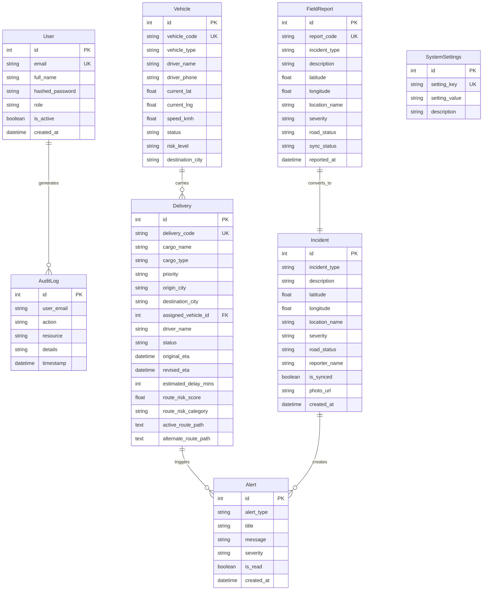

# LINK X8 — Complete Project, Technical Architecture & Feature Specification Master Document

**Smart India Hackathon 2026 Prototype**  
**Problem Statement ID:** SIH26002  
**Official Problem Statement:** AI-Based Smart Logistics and Accessibility Intelligence Platform for North Eastern Region (NER)  
**Organization:** Ministry of Development of North Eastern Region (MDoNER), Government of India  
**Category:** Software  
**Theme:** Transportation & Logistics  
**Tagline:** *Predict. Reroute. Deliver.*

---

## 1. Project Background & Regional Context

### 1.1 Problem Statement Overview
The North Eastern Region (NER) of India—comprising **Assam, Arunachal Pradesh, Manipur, Meghalaya, Mizoram, Nagaland, Sikkim, and Tripura**—faces severe terrain, climatic, and infrastructure constraints:
- **Vulnerable Arterial Highway Corridors:** Heavy dependency on key single-lane or double-lane corridors (e.g., NH27, NH2, NH37, NH10, NH83).
- **Monsoon Hazards:** High precipitation (>75–200 mm/hr) triggers devastating mountain landslides, flash floods, and mudslides.
- **Supply Chain Bottlenecks:** Emergency supplies (oxygen cylinders, life-saving pharmaceuticals, food grains, perishable goods) experience multi-hour or multi-day delays during monsoon blockages.
- **Intermittent Cellular Coverage:** Remote mountain passes (e.g., Senapati Pass, Kohima Pass, Jowai Plateau) lack persistent internet connectivity.

### 1.2 Mission Objectives
**LINK X8** is a Smart Logistics and Accessibility Intelligence Platform designed to monitor accessibility, analyze real-time conditions, identify disruptions, and support intelligent logistics and route decisions for the Ministry of Development of North Eastern Region (MDoNER). It provides:
1. **Predictive Risk Assessment:** Machine learning-based route risk scoring before trucks enter vulnerable corridors.
2. **Dynamic Rerouting:** Immediate calculation and recommendation of detour routes (e.g., Alternate Route B via Silchar/Jiribam on NH37) with revised ETA forecasts.
3. **Offline-First Field Data Collection:** Resilient offline mobile field report queue enabling field officers to log road blockages without active cellular network connectivity.
4. **Command Center Operations:** Real-time GIS corridor tracking, driver telemetry, risk analytics, and role-based access control.

---

## 2. Exhaustive Feature Matrix & Capability Catalog

```
+-----------------------------------------------------------------------------------+
|                             LINK X8 FEATURE MATRIX                                |
+-----------------------------------------------------------------------------------+
| 1. GIS Corridor Intelligence Map  │ 7. Operational Risk Alerts Feed               |
| 2. AI Route Risk Engine (Random   │ 8. Offline Field Reporting & Auto-Sync        |
|    Forest Classifier)             │ 9. Business Intelligence & Analytics          |
| 3. SHAP Explainable AI (XAI)      │ 10. Audit Trail & Compliance Logging          |
| 4. Dynamic Alternate Route B      │ 11. User Management & Role-Based Access       |
|    Reroute Engine                 │ 12. Interactive 7-Step Hackathon Scenario     |
| 5. Live GPS Telemetry Monitoring  │ 13. Configurable System Settings              |
| 6. Logistics Deliveries Manager   │ 14. Responsive Dark/Light UI System           |
+-----------------------------------------------------------------------------------+
```

### 2.1 Complete Feature Breakdown

#### 🗺 1. GIS Corridor Intelligence Map
- **Interactive Map Engine:** Built with Leaflet & OpenStreetMap, tailored specifically for the North Eastern Region coordinates (`26.1445° N, 91.7362° E` Guwahati origin focus).
- **Live Vehicle Markers:** Real-time color-coded vehicle markers (`LOW`=Emerald, `MEDIUM`=Amber, `HIGH`=Orange, `CRITICAL`=Red) displaying live GPS coordinates and simulated telemetry speed.
- **Incident Heat Markers:** Pulsing danger icons denoting landslides, flash floods, and bridge structural damages with status badges (`BLOCKED`, `PARTIAL`, `PASSABLE`).
- **Dual Corridor Polylines:**
  - **Primary Route Polyline (Purple/Rose):** Guwahati ➔ Nagaon ➔ Kohima ➔ Senapati ➔ Imphal (NH27/NH2).
  - **Alternate Route B Polyline (Teal/Emerald):** Detour via Guwahati ➔ Shillong ➔ Silchar ➔ Jiribam ➔ Imphal (NH37/NH83).

#### 🤖 2. AI Route Risk Engine
- **Random Forest Ensemble Model:** Trained on empirical North Eastern Region logistics disruption datasets (`ml/data/ner_logistics_dataset.csv`).
- **Quantitative Risk Score (0 to 100):** Calculates an exact numerical risk score mapped into 4 risk tiers:
  - `LOW` (0 – 24): Optimal transit conditions.
  - `MEDIUM` (25 – 49): Moderate weather or mild traffic congestion.
  - `HIGH` (50 – 74): Heavy rainfall or single-lane obstruction warning.
  - `CRITICAL` (75 – 100): Road blocked / active landslide on pass.

#### 🔍 3. SHAP Explainable AI (XAI)
- **Model Transparency:** Deconstructs AI risk scores into human-readable feature contributions.
- **Primary Risk Factor Ranking:** Identifies exact driver variables (e.g., Rainfall intensity at `75 mm/hr`, Landslide blockage status = `1`, Elevation gain = `1850m`).
- **Command Center Recommendations:** Suggests concrete operational actions based on model inference.

#### 🔀 4. Dynamic Alternate Route B Detour Engine
- **One-Click Dispatcher Approval:** Enables dispatchers to approve rerouting from the Dashboard, Deliveries Page, or GIS Map.
- **Revised ETA Forecast:** Automatically updates estimated travel time and recalculates ETA delay (+35 mins for Silchar detour).
- **Corridor State Synchronization:** Updates vehicle status, active polyline geometry, and audit records instantly across the full stack.

#### 🛰 5. Fleet Vehicles & Driver Telemetry
- **Live GPS Tracking:** Displays vehicle code (e.g., `NER-V001`), vehicle type (`Tata 16-Wheeler Cold-Chain`), destination city, live speed (`65 km/h`), and GPS latitude/longitude.
- **Driver Dispatch Contact:** Quick broadcast call action for drivers with formatted phone telemetry (`+91 98765 00000`).
- **Risk Level Filtering:** Filter fleet by `LOW`, `MEDIUM`, `HIGH`, or `CRITICAL` safety levels.

#### 📦 6. Logistics Deliveries Management
- **Shipment Lifecycle:** Track deliveries by code (`DEL-2026-001`), cargo description (`Life-Saving Oxygen Cylinders & Vaccines`), cargo category (`Medical Supplies`), priority (`Urgent`, `Normal`), and status (`IN_TRANSIT`, `REROUTED`, `DELAYED`, `DELIVERED`).
- **New Shipment Dispatch Modal:** Form to dispatch new cargo across NER corridors with automated initial route risk evaluation.

#### 🔔 7. Operational Risk Alerts Feed
- **Real-Time Notification Feed:** Categorized alerts (`CRITICAL_ROUTE_ALERT`, `OFFLINE_SYNC_INCIDENT`, `WEATHER_WARNING`).
- **Dismiss & Mark Read:** Interactive status updates with unread counter badges.

#### 📱 8. Offline-First Mobile Field Reporting & Auto-Sync
- **Local Queue Persistence:** Saves reports directly to HTML5 `localStorage` queue (`ner_logiai_field_queue`) when field officers are offline in mountain valleys.
- **Network Awareness:** Automatic `navigator.onLine` listener detecting connectivity restoration.
- **Batch Sync Endpoint (`POST /field-reports/sync`):** Transmits offline queue items to the central GIS database, converting field reports into live map incident markers and triggering automatic risk re-evaluation.

#### 📊 9. Business Intelligence & Analytics
- **Regional Accessibility Index:** Quantitative accessibility scores for key corridors (Assam Valleys, Meghalaya Plateau, Barak Valley, Nagaland Pass, Manipur Highway).
- **Interactive Visualizations:** Recharts pie charts and breakdown tables for incidents by type/severity and historical risk trends.

#### 📜 10. Enterprise Audit Trail
- **Compliance Logging:** Automatic audit records for user logins, new user registrations, shipment dispatches, reroute approvals, and offline field syncs.

#### 🔐 11. User Management & Role-Based Access Control (RBAC)
- **Role Permissions:**
  - `Admin`: Full access to user management, system parameters, and all operational pages.
  - `Dispatcher`: Access to fleet management, shipment dispatch, reroute approvals, and alerts.
  - `Field Officer`: Mobile-optimized access for logging incidents and submitting offline field accessibility reports.
  - `Viewer`: Read-only operational dashboard monitoring.

#### 🎬 12. Interactive 7-Step Hackathon Demonstration Scenario Engine
- **Automated Story Stepper:**
  1. `Delivery Started` (Medical supply shipment `DEL-001` on NH27).
  2. `Vehicle Tracking Active` (Simulated GPS telemetry streaming at 65 km/h near Senapati).
  3. `Incident Occurs & Detected` (Landslide near Senapati Mountain Pass).
  4. `Road Accessibility Blocked` (Road status updated to `BLOCKED`).
  5. `AI Risk Engine Escalation` (Risk score escalates to `82/100 CRITICAL`).
  6. `Alternate Route B Calculated` (Detour computed via Silchar/Jiribam NH37 with +35m ETA delay).
  7. `Alert Generated & Dispatcher Notified` (Command center alert generated for reroute approval).

---

## 3. Technology Stack & Software Architecture

```
+----------------------------------------------------------------------------+
|                             CLIENT / FRONTEND                              |
|   React 19.2.8 | Vite 8.2.2 | Tailwind CSS 3.4.17 | Leaflet 1.9.4          |
|   Lucide Icons | Recharts 3.10.1 | Axios 1.20.0 | Context API State        |
+----------------------------------------------------------------------------+
                                      │
                                 HTTP / REST
                                      ▼
+----------------------------------------------------------------------------+
|                             SERVER / BACKEND                               |
|   FastAPI 0.115 | Python 3.13 | Uvicorn ASGI | SQLAlchemy 2.0 ORM        |
|   Pydantic v2 | JWT Auth (HS256) | Passlib (bcrypt) | SQLite / PostGIS     |
+----------------------------------------------------------------------------+
                                      │
                                Inference Call
                                      ▼
+----------------------------------------------------------------------------+
|                              AI / ML ENGINE                                |
|   Scikit-Learn (Random Forest Ensemble) | Pandas | NumPy | SHAP Module   |
+----------------------------------------------------------------------------+
```

### Full Dependencies List

#### Frontend (`frontend/package.json`)
- `react`: `^19.2.8`
- `react-dom`: `^19.2.8`
- `react-router-dom`: `^7.18.3`
- `vite`: `^8.2.2`
- `tailwindcss`: `^3.4.17`
- `leaflet`: `^1.9.4`
- `react-leaflet`: `^5.0.0`
- `recharts`: `^3.10.1`
- `lucide-react`: `^1.39.0`
- `axios`: `^1.20.0`
- `clsx` & `tailwind-merge`

#### Backend (`backend/requirements.txt`)
- `fastapi`: `^0.115.0`
- `uvicorn`: `^0.34.0`
- `sqlalchemy`: `^2.0.38`
- `pydantic`: `^2.10.6`
- `python-jose`: `^3.3.0`
- `passlib`: `^1.7.4`
- `bcrypt`: `^4.3.0`
- `scikit-learn`: `^1.6.1`
- `pandas`: `^2.2.3`
- `numpy`: `^2.2.3`

---

## 4. Database Models & ERD Schemas



---

## 5. Complete API Endpoint Reference

Base URL: `http://127.0.0.1:8000/api/v1`

### 5.1 Authentication (`/auth`)
- `POST /auth/login`: Accepts `{ email, password }`, returns JWT bearer token and user object.
- `POST /auth/register`: Accepts `{ full_name, email, password, role }`, creates user record.

### 5.2 Command Center Dashboard (`/dashboard`)
- `GET /dashboard/summary`: Returns KPI metrics, risk distributions, recent incidents, and active alerts.

### 5.3 Fleet Management (`/vehicles`)
- `GET /vehicles`: List all vehicles with live GPS coordinates and telemetry.
- `POST /vehicles`: Register a new fleet vehicle.
- `GET /vehicles/{vehicle_id}`: Retrieve vehicle details by ID.

### 5.4 Deliveries & Rerouting (`/deliveries`)
- `GET /deliveries`: List active logistics deliveries with risk scores and ETAs.
- `POST /deliveries`: Dispatch a new shipment across NER corridors.
- `GET /deliveries/{delivery_id}`: Get shipment details.
- `POST /deliveries/{delivery_id}/reroute`: Approve rerouting to Alternate Route B (via Silchar / Jiribam).

### 5.5 Road Incidents & Disruption (`/incidents`)
- `GET /incidents`: Retrieve active road blockages and landslides.
- `POST /incidents`: Log new road incident and trigger alert pipeline.

### 5.6 AI Route Risk & Explainability (`/routes`)
- `POST /routes/analyze`: Submit 9-feature parameters to evaluate Random Forest risk score and SHAP explanations.
- `GET /routes/corridors`: Retrieve corridor accessibility status.

### 5.7 Operational Risk Alerts (`/alerts`)
- `GET /alerts`: Fetch real-time system warnings.
- `PUT /alerts/{alert_id}/read`: Mark alert as read / dismissed.

### 5.8 Offline Field Sync (`/field-reports`)
- `GET /field-reports`: Fetch central database field reports.
- `POST /field-reports/sync`: Accept batch JSON queue `{ reports: [...] }`, save to DB, and convert into map incident markers.

### 5.9 BI Analytics (`/analytics`)
- `GET /analytics`: Retrieve regional accessibility indices, historical risk trends, and incident breakdowns.

### 5.10 Compliance & User Administration (`/audit-logs`, `/users`, `/settings`)
- `GET /audit-logs`: Fetch system activity log.
- `GET /users`, `POST /users`: Manage application user accounts.
- `GET /settings`: Fetch configurable system threshold settings.

### 5.11 Hackathon Demo Engine (`/demo`)
- `POST /demo/trigger-landslide`: Trigger master landslide disruption story.
- `POST /demo/reset`: Reset system state to initial clear conditions.

---

## 6. Project Setup & How to Run

### Prerequisites
- **Node.js**: `v18.0.0` or higher
- **Python**: `v3.10` or higher (with `py` launcher on Windows)

### Step 1: Start Backend FastAPI Server
```bash
cd backend
py -m uvicorn app.main:app --host 127.0.0.1 --port 8000
```
- **Backend API**: `http://127.0.0.1:8000`
- **Swagger Documentation**: `http://127.0.0.1:8000/docs`

### Step 2: Start Frontend React App
```bash
cd frontend
npm install
npm run dev
```
- **Web Application URL**: `http://localhost:5173/`

### Step 3: Default Credentials
| Role | Email | Password |
|---|---|---|
| **Admin** | `admin@nerlogiai.in` | `Admin@123` |
| **Dispatcher** | `dispatcher@nerlogiai.in` | `Dispatch@123` |
| **Field Officer** | `field@nerlogiai.in` | `Field@123` |
| **Viewer** | `viewer@nerlogiai.in` | `Viewer@123` |

---

## 7. Data Honesty & SIH Prototype Disclaimer
This prototype strictly follows Smart India Hackathon guidelines:
- All GPS movements, driver telemetry, and weather feeds are explicitly marked with `[SIMULATED GPS TELEMETRY]` badges for prototype demonstration.
- AI Risk metrics are derived from training on `ml/data/ner_logistics_dataset.csv`.
- Developed for Smart India Hackathon 2026 (SIH26002), Ministry of Development of North Eastern Region (MDoNER).
